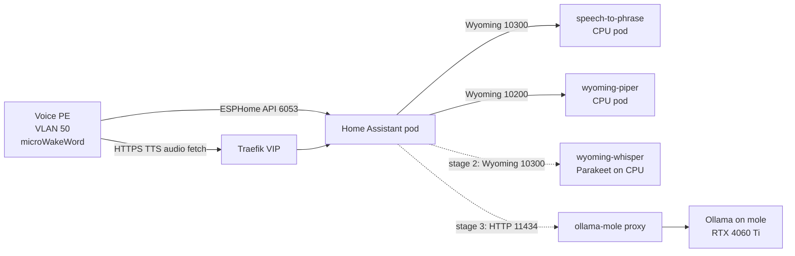

# Local voice assistant: research and plan

Research into local voice control and local AI for Home Assistant, and how it fits this cluster.
Written 2026-10-28 against HA 2026.10.4.
Every claim links a primary source.
Anything I could not confirm from a primary source is marked **unverified**.

## Recommendation in brief

- Run Piper (TTS) and Speech-to-Phrase (STT) as Wyoming services in the cluster, on CPU.
- Use the built-in Home Assistant conversation agent first, with no LLM.
- Buy one Home Assistant Voice Preview Edition as the first satellite,
  because it does wake word on the device.
- Add open-ended STT later with the `wyoming-whisper` image, which picks Parakeet on CPU for English.
- Add an LLM last, through the Ollama that already runs on mole, with "prefer handling commands locally" on.
- Keep GPU STT on mole as an option only if CPU STT is too slow.

The rest of this document explains why, and lists what is still unknown.

## How Assist works

Assist is HA's voice assistant.
It can run fully on local hardware, or hand parts to an LLM or to Home Assistant Cloud
([Assist](https://www.home-assistant.io/voice_control/)).
Home Assistant Cloud was renamed Home Assistant Link on 2026-10-02
([blog](https://www.home-assistant.io/blog/2026/10/02/big-tech-ruined-the-cloud-so-were-renaming-ours/)).

An assistant (a pipeline) has four stages
([local setup guide](https://www.home-assistant.io/voice_control/voice_remote_local_assistant/)):

| Stage              | Job                                | Where it can run                                                   |
| ------------------ | ---------------------------------- | ------------------------------------------------------------------ |
| Wake word          | Hear "Okay Nabu" and start         | On the satellite (microWakeWord) or on a server (openWakeWord)     |
| Speech-to-text     | Turn audio into text               | Wyoming server (Speech-to-Phrase, Whisper) or cloud                |
| Conversation agent | Turn text into an action and reply | Inside HA (built-in intents) or an LLM integration (Ollama, cloud) |
| Text-to-speech     | Turn the reply into audio          | Wyoming server (Piper) or cloud                                    |

- Satellites stream audio to HA.
  HA runs the pipeline and the satellite fetches the TTS audio back from HA's URL
  ([troubleshooting](https://www.home-assistant.io/voice_control/troubleshooting/#i-dont-get-a-voice-response)).
- Entities must be exposed to Assist before voice can control them
  ([exposing entities](https://www.home-assistant.io/voice_control/voice_remote_expose_devices/)).
- Since 2025.10 a satellite can have up to two wake words, each with its own pipeline.
  One can be fully local and the other can use an LLM
  ([Voice chapter 11](https://www.home-assistant.io/blog/2025/10/22/voice-chapter-11/)).
- Since 2025.10 a command whose actions all happen in the satellite's area gets a short beep,
  not a spoken reply.
  This does not apply to LLM pipelines ([Voice chapter 11](https://www.home-assistant.io/blog/2025/10/22/voice-chapter-11/)).
- An assistant can "act as" a person, so linked accounts such as Music Assistant work
  ([local setup guide](https://www.home-assistant.io/voice_control/voice_remote_local_assistant/#letting-an-assistant-act-as-a-user)).

## Wyoming protocol

Wyoming is a peer-to-peer TCP protocol for voice services:
a JSON line header followed by optional data and PCM audio
([OHF-Voice/wyoming](https://github.com/OHF-Voice/wyoming)).
It covers wake word, STT, TTS, intent handling and satellites.

- **No authentication or encryption, by design.**
  It is meant for a trusted network ([OHF-Voice/wyoming](https://github.com/OHF-Voice/wyoming#security)).
  In the cluster this means a NetworkPolicy should allow only HA to connect.
- HA discovers Wyoming services over zeroconf as `_wyoming._tcp.local.`
  ([wyoming manifest](https://github.com/home-assistant/core/blob/dev/homeassistant/components/wyoming/manifest.json)).
  mDNS does not cross into the pod network here (the ESPHome HelmRelease says the same),
  so add each service by hand.
- Manual setup: Settings > Devices & services > Add integration > Wyoming Protocol, then host and port
  ([Wyoming integration](https://www.home-assistant.io/integrations/wyoming/)).
- Conventional ports:

| Service                    | Port  | Source                                                                                                                                           |
| -------------------------- | ----- | ------------------------------------------------------------------------------------------------------------------------------------------------ |
| Piper (TTS)                | 10200 | [wyoming-piper](https://github.com/OHF-Voice/wyoming-piper)                                                                                      |
| Whisper / Speech-to-Phrase | 10300 | [wyoming-faster-whisper](https://github.com/OHF-Voice/wyoming-faster-whisper), [speech-to-phrase](https://github.com/OHF-Voice/speech-to-phrase) |
| openWakeWord               | 10400 | [wyoming-openwakeword](https://github.com/rhasspy/wyoming-openwakeword)                                                                          |

ESPHome satellites (Voice PE, S3-Box) do not use Wyoming to talk to HA.
They use the ESPHome native API on port 6053 ([ESPHome API](https://esphome.io/components/api/)).
HA streams mic audio over that API connection when the firmware supports it,
and otherwise opens a UDP server on a random port
([esphome assist_satellite.py](https://github.com/home-assistant/core/blob/dev/homeassistant/components/esphome/assist_satellite.py)).
The UDP fallback would not work from a pod that is not on the host network,
so keep satellite firmware current.
Which ESPHome release added API audio is **unverified**.

## Speech-to-text

HA documents two local options
([local setup guide](https://www.home-assistant.io/voice_control/voice_remote_local_assistant/#some-options-for-speech-to-text-and-text-to-speech)).

### Speech-to-Phrase

Speech-to-Phrase is closed-ended.
It answers "which of my known phrases was said?", not "what was said?"
([speech-to-phrase README](https://github.com/OHF-Voice/speech-to-phrase)).

- It builds its grammar from sentence templates plus the names of exposed entities, areas and floors.
- It is fast: under one second on a Pi 4 or Green, 150 ms per command on a Pi 5
  ([Voice chapter 9](https://www.home-assistant.io/blog/2025/02/13/voice-chapter-9-speech-to-phrase/)).
- It cannot handle open-ended input such as shopping list items or timer names out of the box,
  and it is meant for home control, not for LLMs
  ([local setup guide](https://www.home-assistant.io/voice_control/voice_remote_local_assistant/#speech-to-phrase)).
- The standalone Docker image is `rhasspy/wyoming-speech-to-phrase`, latest tag `1.4.3` (Kaldi based).
  It needs a HA long-lived token and the HA websocket URL
  ([speech-to-phrase README](https://github.com/OHF-Voice/speech-to-phrase#docker-container),
  [Docker Hub](https://hub.docker.com/r/rhasspy/wyoming-speech-to-phrase/tags)).
- Development has moved to [OHF-Voice/apps](https://github.com/OHF-Voice/apps/tree/main/speech-to-phrase).
  Version 2.2.0 there is a rewrite with a CTC decoder, a web UI to choose commands,
  and English on Parakeet TDT-CTC 110M
  ([CHANGELOG](https://github.com/OHF-Voice/apps/blob/main/speech-to-phrase/CHANGELOG.md),
  [DOCS](https://github.com/OHF-Voice/apps/blob/main/speech-to-phrase/DOCS.md)).
  It reports "tens of milliseconds once warm".
  It is packaged as a HA app (Supervisor add-on) with no published standalone image that I could find.
  Whether 2.x can run outside the Supervisor is **unverified**, so this cluster would start on 1.4.3.

### Whisper (wyoming-faster-whisper)

Whisper is open-ended and transcribes anything, at a higher compute cost.
HA quotes about 8 s on a Pi 4 and under 1 s on an Intel NUC
([local setup guide](https://www.home-assistant.io/voice_control/voice_remote_local_assistant/#whisper)).

The `wyoming-faster-whisper` server is now a multi-backend STT server, not only Whisper
([README](https://github.com/OHF-Voice/wyoming-faster-whisper)):

- Image `rhasspy/wyoming-whisper`, current tag `3.8.1` (2026-09-14), about 1.6 GB
  ([Docker Hub](https://hub.docker.com/r/rhasspy/wyoming-whisper/tags)).
- Backends: `faster-whisper`, `transformers`, `sherpa` (Parakeet TDT), `qwen3-asr`, `funasr`, `onnx-asr`.
- With the default `--stt-library auto` and no `--model`, English goes to Parakeet through sherpa-onnx
  ([models.py](https://github.com/OHF-Voice/wyoming-faster-whisper/blob/main/wyoming_faster_whisper/models.py)).
  The CPU image installs the `sherpa` extra
  ([Dockerfile](https://github.com/OHF-Voice/wyoming-faster-whisper/blob/main/Dockerfile)).
  So the "Whisper" container is Parakeet on CPU for English by default.
  Its latency on these nodes is **unverified**.
- It can read exposed entity, area and floor names from HA and use them as a prompt,
  which fixes misheard device names (`--hass-token`, `--hass-api`).
- It can end a command on server-side silence detection (`--vad-endpointing`).
- Whisper model names offered by the HA app:
  `tiny`, `base`, `small`, `medium` (each with `int8` and `.en` variants),
  `large-v1` to `large-v3`, `distil-*` and `turbo`.
  The app's `auto` picks `tiny-int8` on ARM and `base-int8` otherwise
  ([Whisper app DOCS](https://github.com/home-assistant/addons/blob/master/whisper/DOCS.md)).
- One published figure: qwen3-asr 0.6B on a Pi 5 took 2.20 s for a 3.2 s command
  ([README](https://github.com/OHF-Voice/wyoming-faster-whisper)).

GPU:

- The CUDA image is not published. You build it from `Dockerfile.gpu` (about 10.7 GB)
  and run it with `--gpus all` and the NVIDIA Container Toolkit
  ([README, GPU image](https://github.com/OHF-Voice/wyoming-faster-whisper#gpu-image)).
- It defaults to `Systran/faster-whisper-small` in float16 and "can comfortably run" `large-v3`.
- NVIDIA and amd64 only. CTranslate2 has no ROCm backend, so the AMD iGPU cannot run faster-whisper.
- `--stt-library sherpa` still runs on CPU in the GPU image.
- It is built on CUDA 12.8 ([CHANGELOG](https://github.com/OHF-Voice/wyoming-faster-whisper/blob/main/CHANGELOG.md)).
  CUDA 12.8 wants driver 570.26 or later,
  but CUDA 12.x minor version compatibility accepts drivers from 525 to below 580
  ([CUDA release notes](https://docs.nvidia.com/cuda/cuda-toolkit-release-notes/index.html)).
  Whether it runs on mole's driver is **unverified** (see open questions).
- VRAM use for each Whisper size is **unverified**.

### Recommended default, late 2026

There is no single official default.
HA's guide says Speech-to-Phrase is "a great option for home control" and Whisper suits powerful hardware
or a setup paired with an LLM
([local setup guide](https://www.home-assistant.io/voice_control/voice_remote_local_assistant/)).
For this cluster: Speech-to-Phrase first, then `rhasspy/wyoming-whisper` with its English default (Parakeet)
once an LLM needs free-form text.

## Text-to-speech

Piper is the local TTS that HA develops
([local setup guide](https://www.home-assistant.io/voice_control/voice_remote_local_assistant/#text-to-speech-engine),
[piper1-gpl](https://github.com/OHF-Voice/piper1-gpl)).

- Image `rhasspy/wyoming-piper`, current tag `2.5.2` (2026-09-11), port 10200
  ([wyoming-piper](https://github.com/OHF-Voice/wyoming-piper),
  [Docker Hub](https://hub.docker.com/r/rhasspy/wyoming-piper/tags)).
- CPU cost: a Pi generates 1.6 s of speech per second with medium-quality voices
  ([local setup guide](https://www.home-assistant.io/voice_control/voice_remote_local_assistant/#text-to-speech-engine)).
  Figures for x86 nodes are **unverified**, but should be well above that.
- Voices download from Hugging Face on first use into `/data`, so give it a PVC.
- English voices exist for `en_GB` and `en_US` only, at `low`, `medium` and `high` quality
  ([voices.json](https://huggingface.co/rhasspy/piper-voices/blob/main/voices.json)).
  There is no `en_AU` voice. Samples are at [piper-samples](https://rhasspy.github.io/piper-samples/).
- Streaming TTS (2025.9) starts speaking while an LLM is still writing.
  HA measured 0.56 s to first audio with Piper and Ollama `gemma3:4b` on an RTX 3090,
  against 5.31 s without streaming
  ([AI in Home Assistant](https://www.home-assistant.io/blog/2025/09/11/ai-in-home-assistant/)).
- A newer, experimental backend is OmniVoice (`rhasspy/wyoming-piper:omnivoice`), with voice cloning.
  It is "compute-heavy" and amd64 only ([wyoming-piper](https://github.com/OHF-Voice/wyoming-piper)).
  HA has not recommended it over Piper in any post I found.
- The 2.5.1 image turns off ONNX Runtime telemetry, which 1.29.0 had turned on
  ([CHANGELOG](https://github.com/OHF-Voice/wyoming-piper/blob/main/CHANGELOG.md)).
  Pin 2.5.1 or later.

## Wake word

Two engines, decided by where the wake word runs
([HA approach to wake words](https://www.home-assistant.io/voice_control/about_wake_word/)).

| Engine        | Runs on                           | Notes                                                                        |
| ------------- | --------------------------------- | ---------------------------------------------------------------------------- |
| microWakeWord | The satellite (ESP32-S3, Android) | Small model. Voice PE and S3-Box-3 use it. Saves HA CPU and network traffic. |
| openWakeWord  | A server, over Wyoming (10400)    | For satellites that only stream audio, such as the Atom Echo. English only.  |

- Server-side wake word costs HA resources for every streaming satellite
  ([HA approach to wake words](https://www.home-assistant.io/voice_control/about_wake_word/#drawbacks-of-this-approach)).
- ESPHome configures microWakeWord models such as `okay_nabu` and `hey_mycroft`, with an optional VAD model
  ([ESPHome micro_wake_word](https://esphome.io/components/micro_wake_word/)).
- Since 2026.3 the Android companion app does on-device wake word with microWakeWord (experimental)
  ([2026.3 release](https://www.home-assistant.io/blog/2026/03/04/release-20263/#wake-word-detection-on-your-android-phone-experimental)).
- `rhasspy/wyoming-openwakeword` is at `2.1.0` (2025-10-28)
  ([Docker Hub](https://hub.docker.com/r/rhasspy/wyoming-openwakeword/tags)).

With Voice PE satellites there is no need to run openWakeWord.

## Conversation agents

### Built-in agent

The default agent matches sentences against community intent templates, in many languages
([Conversation](https://www.home-assistant.io/integrations/conversation/)).

- It is extended with `custom_sentences/<lang>/*.yaml` and `intent_script`.
- Sentence triggers start automations from a phrase.
- It needs no GPU and replies in milliseconds once STT is done.
  That figure is **unverified**, but it is pattern matching.

### Local LLM through Ollama

The [Ollama integration](https://www.home-assistant.io/integrations/ollama/) adds a conversation agent backed by an
external Ollama server.

- "Control Home Assistant" gives the model the Assist API. Only models that support tools can control HA.
- HA recommends exposing fewer than 25 entities when experimenting with local LLMs.
- A tip from the docs: add two Ollama entries on the same model, one chat-only and one with control.
- Defaults in the integration code:
  model `qwen3:4b-instruct`, context 8192 tokens, keep-alive `-1` (never unload),
  thinking off, 20 history messages
  ([const.py](https://github.com/home-assistant/core/blob/dev/homeassistant/components/ollama/const.py)).
- Keep-alive `-1` pins the model in VRAM. This matters on a shared GPU.
- Ollama tool calling works through a `tools` list in the chat request
  ([Ollama tool calling](https://docs.ollama.com/capabilities/tool-calling)).
- Ollama's own context default is 4096.
  It keeps up to 3 models per GPU and queues requests when a model does not fit
  ([Ollama FAQ](https://docs.ollama.com/faq)).
- Since 2026.8 there is also a LiteLLM conversation agent
  ([2026.8 release](https://www.home-assistant.io/blog/2026/08/05/release-20268/)).
- Since 2026.9 LLM tool names carry a domain prefix, for example `homeassistant__GetLiveContext`
  ([2026.9 release](https://www.home-assistant.io/blog/2026/09/02/release-20269/)).
  Custom prompts that name tools need updating.

### "Prefer handling commands locally"

This setting "always attempts to run commands with the built-in conversation agent
before it sends it off to an LLM"
([Voice chapter 9](https://www.home-assistant.io/blog/2025/02/13/voice-chapter-9-speech-to-phrase/)).
Simple commands stay fast and local.
Anything the intents do not match goes to the LLM, and history is shared, so follow-ups still work.
Keep it on.

### LLM API, MCP

- The built-in Assist LLM API exposes the same intents and exposed entities as the built-in agent,
  with no admin actions ([developer docs](https://developers.home-assistant.io/docs/core/llm/)).
- **MCP server**: lets an outside AI client (Claude, ChatGPT, Codex) control HA.
  Since 2026.10 it is enabled from Settings > System > AI in one click
  ([MCP Server](https://www.home-assistant.io/integrations/mcp_server/),
  [2026.10 release](https://www.home-assistant.io/blog/2026/10/07/release-202610/#connect-your-ai-in-one-click)).
  This is separate from the voice path.
- **MCP client**: gives HA's LLM agent extra tools from an MCP server over SSE.
  Tools only, no prompts or resources
  ([MCP](https://www.home-assistant.io/integrations/mcp/)).

### Which local model

HA's AI post points to the Home LLM Leaderboard and says local models using 8 GB or more of VRAM are
"nearly keeping up" with cloud models
([AI in Home Assistant](https://www.home-assistant.io/blog/2025/09/11/ai-in-home-assistant/),
[leaderboard reports](https://github.com/allenporter/home-assistant-datasets/tree/main/reports)).

Selected scores from the leaderboard (assist / assist-mini):

| Model             | assist | assist-mini | Ollama download size                                                |
| ----------------- | ------ | ----------- | ------------------------------------------------------------------- |
| qwen3-4b-instruct | 71.7%  | 86.7%       | 2.5 GB for `qwen3:4b` ([library](https://ollama.com/library/qwen3)) |
| qwen3.5-4b        | 81.1%  | 88.3%       | **unverified**                                                      |
| qwen3-8b          | 82.8%  | 93.4%       | 5.2 GB ([library](https://ollama.com/library/qwen3))                |
| ministral-3-8b    | 78.0%  | 93.9%       | **unverified**                                                      |
| gemma4-12b        | 83.5%  | 97.4%       | **unverified**                                                      |
| qwen3-14b         | 79.3%  | 98.0%       | 9.3 GB ([library](https://ollama.com/library/qwen3))                |
| gpt-oss-20b       | 87.6%  | 95.4%       | **unverified**                                                      |

VRAM needed is the download size plus KV cache for the context, so add a margin for an 8k context.
Fit per model is **unverified**.
On 8 GB, a 4B model is the realistic choice while other models share the card.
On 16 GB, an 8B or 12B model is plausible.

## Hardware

- **Home Assistant Voice Preview Edition** is the recommended hardware
  ([Assist](https://www.home-assistant.io/voice_control/), [Voice PE](https://www.home-assistant.io/voice-pe/)).
  Dual mics with an XMOS audio chip, a hardware mute switch, a 3.5 mm out, and an LED ring.
  Recommended MSRP $69 USD / 59 EUR. It runs microWakeWord on the device
  ([2026.3 release](https://www.home-assistant.io/blog/2026/03/04/release-20263/)).
  Docs: [voice-pe.home-assistant.io](https://voice-pe.home-assistant.io/documentation/).
- **Successor**: none announced on the HA blog up to 2026-10-27.
  Nabu Casa's teased "Project Blast" is an IR and RF device, not voice
  ([2026.5 release](https://www.home-assistant.io/blog/2026/05/06/release-20265/)).
- **ESP32-S3-BOX-3 / 3B**: supported through an official ESPHome firmware with a web installer
  ([tutorial](https://www.home-assistant.io/voice_control/s3_box_voice_assistant/)).
  Official price not found.
- **$13 voice remote (M5 Atom Echo)**: streams audio only, so it needs openWakeWord on a server
  ([Assist](https://www.home-assistant.io/voice_control/),
  [HA approach to wake words](https://www.home-assistant.io/voice_control/about_wake_word/)).
- **Linux Voice Assistant**: experimental Linux satellite that speaks the ESPHome API,
  with on-device wake word.
  Suggested hardware is a Pi Zero 2W with a Satellite1 HAT or a Pi 3 with a ReSpeaker Lite
  ([linux-voice-assistant](https://github.com/OHF-Voice/linux-voice-assistant)).
- **Android phone** with the companion app (2026.3 on-device wake word, experimental).
- ESPHome warns that voice components use a lot of device RAM and CPU, and Bluetooth with voice causes crashes
  ([voice_assistant](https://esphome.io/components/voice_assistant/)).

## What exists in this repo

- **Home Assistant** runs from `apps/production/apps/home-assistant/` with bjw-s `app-template`,
  image `ghcr.io/home-operations/home-assistant:2026.10.4`, not on the host network.
  It is reached at `ha.home.lewelly.com` through the Traefik gateway.
  HA is the Container install, so there is no Supervisor and HA apps (add-ons) are not available.
- **ESPHome dashboard** runs in `apps/production/apps/esphome/` on the host network,
  pinned to `talos-master-3` (`esphome=true`) for the OPNsense VLAN 20 to VLAN 50 rule.
- **Ollama on mole**: `apps/production/apps/ollama-mole/` points a selector-less Service and EndpointSlice at
  `10.10.20.20:11434`, with an exporter that also proxies the API.
  In-cluster URL: `http://ollama-mole.ollama-mole.svc.cluster.local:11434`.
  OpenViking already uses it for `qwen3-embedding:4b` and an intent model.
- **AMD iGPU**: `talos-master-1` and `talos-master-2` pass through the Raphael iGPU (`gpu: amd-igpu`).
  Jellyfin uses it.
  An in-cluster ROCm and Vulkan Ollama was tried and removed in favour of mole (#221).
- **No Wyoming, Piper, Whisper or openWakeWord** exists yet.
- The `home-assistant` namespace has no NetworkPolicy.

## Fit for this cluster

### Architecture

| Component          | Runs where                      | Image                                    | Why                                               |
| ------------------ | ------------------------------- | ---------------------------------------- | ------------------------------------------------- |
| Wake word          | Voice PE                        | firmware                                 | No server cost                                    |
| Speech-to-Phrase   | Cluster, CPU                    | `rhasspy/wyoming-speech-to-phrase:1.4.3` | Fast, closed-ended, no GPU                        |
| Piper              | Cluster, CPU                    | `rhasspy/wyoming-piper:2.5.2`            | Light on CPU                                      |
| Open-ended STT     | Cluster, CPU (stage 2)          | `rhasspy/wyoming-whisper:3.8.1`          | Parakeet default for English, no GPU build needed |
| LLM                | mole, existing Ollama (stage 3) | existing                                 | Only NVIDIA GPU, already wired into the cluster   |
| GPU STT (optional) | mole, Docker on TrueNAS         | self-built `wyoming-whisper:gpu`         | Only if CPU STT is too slow                       |

Why not the iGPU: faster-whisper has no ROCm backend, the earlier ROCm Ollama was dropped,
and iGPU nodes can wedge on warm reboot.

### Kubernetes shape

- A new `voice` namespace under `apps/production/apps/voice/`,
  listed in `apps/production/apps/kustomization.yaml`.
  One `app-template` HelmRelease per service, copied from the radarr pattern with pinned digests.
- One controller per service, `strategy: Recreate`, a small RWO PVC on `rook-ceph-block` for `/data`.
  Models and voices download on first start and are reused after.
  Speech-to-Phrase 1.4.3 also needs a `/train` volume
  ([README](https://github.com/OHF-Voice/speech-to-phrase#docker-container)).
- ClusterIP Services only. HA reaches them as `<svc>.voice.svc.cluster.local` on 10200 and 10300.
  No LoadBalancer is needed because only HA connects.
- Probes: TCP on the Wyoming port. Both images ship a health check module that could back an exec probe.
- A SOPS-encrypted Secret holds a HA long-lived token for Speech-to-Phrase,
  and later for Whisper name biasing.
  Whisper reads it from a file through `WYO_WHISPER_HASS_TOKEN_FILE`.
- HA's internal URL for these services is `http://home-assistant.home-assistant.svc.cluster.local:8123`.
- Resource requests are **unverified**.
  Start Piper and Speech-to-Phrase near 500m CPU and 1 GiB, then tune from metrics.
- Wyoming config lives in HA's `.storage`, set through the UI.
  It is not GitOps managed, but it is in the VolSync backup.

### NetworkPolicy and firewall

- Wyoming has no auth, so the `voice` namespace gets default deny plus:
  - ingress from `home-assistant` pods to 10200 and 10300 only,
  - egress to kube-dns,
  - egress to HA on 8123 for Speech-to-Phrase and Whisper name lookups,
  - egress to the internet on 443 for the first model download (Hugging Face).
    Whisper supports `--local-files-only` once models are cached
    ([README](https://github.com/OHF-Voice/wyoming-faster-whisper#running-without-internet-access)).
- If a NetworkPolicy is later added to `home-assistant`, it must allow egress to `voice`, to mole on 11434
  (or the `ollama-mole` proxy), and to VLAN 50 on 6053.
- Follow the `date-jar` NetworkPolicy as the pattern.
- **OPNsense**: the Voice PE must reach HA to fetch TTS audio.
  HA's "Local Network" URL must be one the IoT VLAN can resolve and reach
  ([troubleshooting](https://www.home-assistant.io/voice_control/troubleshooting/#local-network-settings)).
  That needs a VLAN 50 to Traefik VIP rule on 443, plus DNS for `ha.home.lewelly.com`,
  or a plain-HTTP internal URL.
- HA must reach the satellite on 6053. The existing ESPHome heat pump controllers suggest this already works,
  but the HA pod is not pinned to the `esphome=true` node, so check what the OPNsense rule allows.

### Latency expectations

Rough end-to-end budget after the wake word, for a simple command:

| Stage                          | Expected                   | Basis                                                                                                                                                                                                                                |
| ------------------------------ | -------------------------- | ------------------------------------------------------------------------------------------------------------------------------------------------------------------------------------------------------------------------------------ |
| Speech-to-Phrase               | well under 1 s             | 150 ms on a Pi 5 ([chapter 9](https://www.home-assistant.io/blog/2025/02/13/voice-chapter-9-speech-to-phrase/))                                                                                                                      |
| Parakeet / Whisper on node CPU | about 1 s, **unverified**  | under 1 s on an Intel NUC for Whisper ([guide](https://www.home-assistant.io/voice_control/voice_remote_local_assistant/#whisper))                                                                                                   |
| Built-in agent                 | negligible, **unverified** | pattern matching                                                                                                                                                                                                                     |
| Ollama 4B on 4060 Ti           | **unverified**             | no primary benchmark for this card                                                                                                                                                                                                   |
| Piper, first audio             | under 1 s                  | 1.6x real time on a Pi ([guide](https://www.home-assistant.io/voice_control/voice_remote_local_assistant/#text-to-speech-engine)), streaming 0.56 s ([AI post](https://www.home-assistant.io/blog/2025/09/11/ai-in-home-assistant/)) |
| Non-verbal confirmation        | a beep, no TTS             | [chapter 11](https://www.home-assistant.io/blog/2025/10/22/voice-chapter-11/)                                                                                                                                                        |

Measure with the pipeline debug view (Settings > Voice assistants > Debug)
([troubleshooting](https://www.home-assistant.io/voice_control/troubleshooting/#view-debug-information)).

## Staged rollout

1. **Local, CPU only.**
   Deploy `wyoming-piper` and `wyoming-speech-to-phrase` in `voice`.
   Add both as Wyoming integrations.
   Create an assistant: Speech-to-Phrase, agent "Home Assistant", Piper with an `en_GB` voice.
   Expose a small set of entities, and add area aliases.
   Test from the HA app, then buy one Voice PE and open the firewall for it.
2. **Open-ended STT on CPU.**
   Add `wyoming-whisper` with `--language en` and no `--model`, so it uses Parakeet.
   Turn on HA name biasing with the token.
   Compare accuracy and latency with Speech-to-Phrase in the debug view.
   Keep Speech-to-Phrase on the local-only wake word.
3. **LLM on mole's GPU.**
   Add the Ollama integration pointed at `http://ollama-mole.ollama-mole.svc.cluster.local:11434`.
   Start with `qwen3:4b-instruct` (the HA default) and fewer than 25 exposed entities.
   Turn on "prefer handling commands locally".
   Set keep-alive deliberately, because `-1` pins the model next to OpenViking's.
   Put the LLM pipeline on the second wake word, with Whisper or Parakeet as its STT.
4. **Optional: GPU STT on mole.**
   Only if stage 2 is too slow.
   Build `Dockerfile.gpu` on the TrueNAS VM and run it on 10300.
   Point a Wyoming entry at `10.10.20.20:10300`.
   Add a selector-less Service like `ollama-mole` if in-cluster naming or metrics are wanted.
5. **Later.**
   More satellites, custom sentences, sentence-trigger automations, and the MCP server for outside AI clients.

## Open questions and unknowns

- **mole's VRAM (checked 2026-10-28).** `nvidia-smi` shows an 8 GB RTX 4060 Ti on driver 550.142 (CUDA 12.4).
  Ollama 0.30.10 holds `qwen3-embedding:4b` at about 4.2 GB, which leaves under 4 GB free.
  The other installed models are small embedders and the OpenViking intent model.
  So stage 3 needs a 4B model or smaller, or the embedder must unload while voice runs.
- **GPU sharing.** Ollama (OpenViking embeddings and intent model), tdarr NVENC, an HA model and maybe Whisper
  would share one card. Ollama queues requests when a model does not fit ([FAQ](https://docs.ollama.com/faq)),
  so a voice request could wait behind an embedding job. Needs testing.
- **CUDA 12.8 image on mole.** The Whisper GPU image is CUDA 12.8.
  Minor version compatibility should allow drivers 525 to below 580
  ([CUDA release notes](https://docs.nvidia.com/cuda/cuda-toolkit-release-notes/index.html)).
  Operator notes record driver 550 and a past forward-compat failure in another CUDA image.
  **Unverified** until tried.
- **How Ollama runs on mole** (TrueNAS app or plain Docker), and whether a Whisper container can be added
  the same way. Not in the repo.
- **Parakeet and Piper latency on the Talos nodes.** No primary figures for this CPU.
- **Speech-to-Phrase 2.x outside the Supervisor.** No standalone image found. 1.4.3 is the fallback.
- **Satellite to HA path.** Whether the IoT VLAN can reach the Traefik VIP and resolve `ha.home.lewelly.com`,
  and whether the OPNsense VLAN 20 to 50 rule covers whichever node HA lands on.
- **Accent.** No `en_AU` Piper voice and no Australian-English accuracy data for Parakeet or Speech-to-Phrase.
- **Model VRAM fit.** Leaderboard scores are primary, but VRAM per model with an 8k context is my estimate.
- **Voice PE in Australia.** Local availability and price not checked.

## Sources

- Home Assistant docs:
  [Assist](https://www.home-assistant.io/voice_control/),
  [local pipeline](https://www.home-assistant.io/voice_control/voice_remote_local_assistant/),
  [Wyoming](https://www.home-assistant.io/integrations/wyoming/),
  [wake words](https://www.home-assistant.io/voice_control/about_wake_word/),
  [Conversation](https://www.home-assistant.io/integrations/conversation/),
  [Ollama](https://www.home-assistant.io/integrations/ollama/),
  [MCP Server](https://www.home-assistant.io/integrations/mcp_server/),
  [MCP](https://www.home-assistant.io/integrations/mcp/),
  [exposing entities](https://www.home-assistant.io/voice_control/voice_remote_expose_devices/),
  [troubleshooting](https://www.home-assistant.io/voice_control/troubleshooting/),
  [S3-Box tutorial](https://www.home-assistant.io/voice_control/s3_box_voice_assistant/),
  [Voice PE](https://www.home-assistant.io/voice-pe/),
  [LLM developer docs](https://developers.home-assistant.io/docs/core/llm/).
- Home Assistant blog:
  [Voice chapter 9](https://www.home-assistant.io/blog/2025/02/13/voice-chapter-9-speech-to-phrase/),
  [AI in Home Assistant](https://www.home-assistant.io/blog/2025/09/11/ai-in-home-assistant/),
  [Voice chapter 11](https://www.home-assistant.io/blog/2025/10/22/voice-chapter-11/),
  [2026.3](https://www.home-assistant.io/blog/2026/03/04/release-20263/),
  [2026.5](https://www.home-assistant.io/blog/2026/05/06/release-20265/),
  [2026.8](https://www.home-assistant.io/blog/2026/08/05/release-20268/),
  [2026.9](https://www.home-assistant.io/blog/2026/09/02/release-20269/),
  [2026.10](https://www.home-assistant.io/blog/2026/10/07/release-202610/).
- Code and READMEs:
  [home-assistant/core](https://github.com/home-assistant/core),
  [home-assistant/addons whisper](https://github.com/home-assistant/addons/tree/master/whisper),
  [OHF-Voice/wyoming](https://github.com/OHF-Voice/wyoming),
  [wyoming-faster-whisper](https://github.com/OHF-Voice/wyoming-faster-whisper),
  [wyoming-piper](https://github.com/OHF-Voice/wyoming-piper),
  [piper1-gpl](https://github.com/OHF-Voice/piper1-gpl),
  [speech-to-phrase](https://github.com/OHF-Voice/speech-to-phrase),
  [OHF-Voice/apps](https://github.com/OHF-Voice/apps),
  [wyoming-openwakeword](https://github.com/rhasspy/wyoming-openwakeword),
  [linux-voice-assistant](https://github.com/OHF-Voice/linux-voice-assistant),
  [home-assistant-datasets](https://github.com/allenporter/home-assistant-datasets).
- ESPHome:
  [voice_assistant](https://esphome.io/components/voice_assistant/),
  [micro_wake_word](https://esphome.io/components/micro_wake_word/),
  [api](https://esphome.io/components/api/).
- Ollama: [FAQ](https://docs.ollama.com/faq), [tool calling](https://docs.ollama.com/capabilities/tool-calling),
  [qwen3](https://ollama.com/library/qwen3).
- NVIDIA: [RTX 4060 Ti](https://www.nvidia.com/en-us/geforce/graphics-cards/40-series/rtx-4060-4060ti/),
  [CUDA release notes](https://docs.nvidia.com/cuda/cuda-toolkit-release-notes/index.html).
